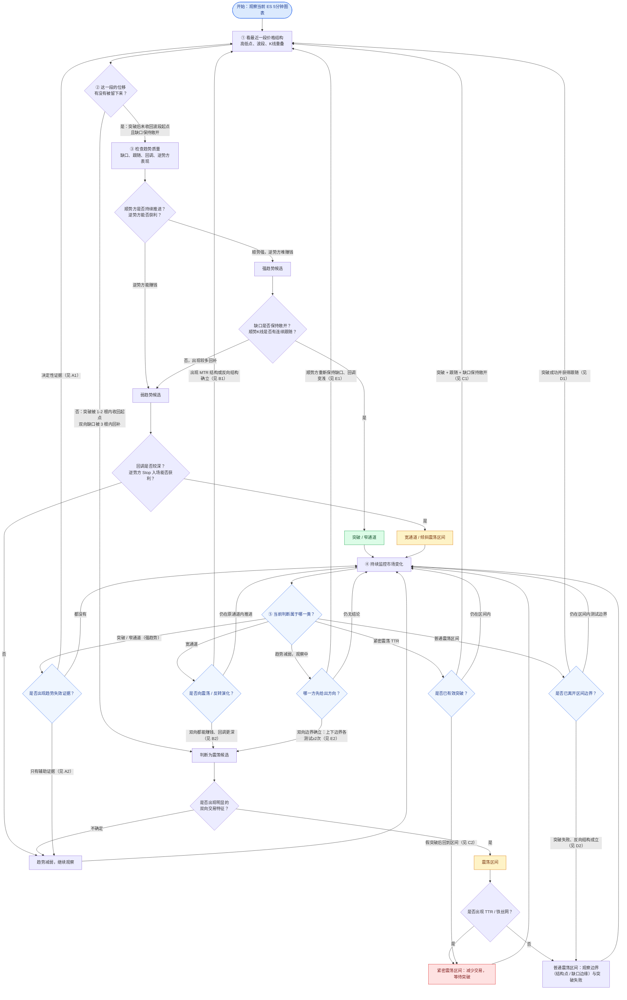

> 交互版见同目录 `ZPA决策流程图.html`：点击节点看说明、切换「失效判定」可勾选证据并实时给出结论。下方 mermaid 为纯文本版，便于编辑与版本对比。

---

## 判定说明：什么算“足以改变原判断的证据”

> 本节的完整论述见 ZPA.md 2.5「市场状态的切换与失效判定」；此处只保留判定时要用到的清单。

三条前提原则：

1. **单条线索只能降级，两条以上共振才能改判。** 一根大阴线不构成改判理由，它只让“强趋势”变成“趋势减弱，继续观察”。
2. **证据必须可以被否证。** 说得出“什么情况出现，我就承认这条证据不成立”，才算证据；否则只是情绪。
3. **改判的动作是回到 ② 重走一遍判断流程**，不是直接跳到对面的结论。震荡突破成功之后，要通过 C 重新确认是否存在单方向推进，而不是立刻当成趋势。

### A. 突破 / 窄通道（强趋势）的失效

**A1 决定性证据**（任一成立即改判，回 ②）

- 逆势方制造出缺口，并且保持敞开超过 3 根 K 线（不是一闪而过的针）。
- 逆势方回补实体缺口后，顺势方连续 3 根以上无法收复该区域。
- 逆势方**用 Stop 入场**也能持续获利——不是靠限价单在极值捡针，而是追进去也能赚钱。

**A2 辅助证据**（只够把 I 降级为 L，不够改判）

- 回调超过前一段趋势的 50%，或回调持续超过 20 根 K 线。
- 创新高 / 新低的幅度递减（如 10 点 → 5 点 → 2 点）。
- 顺势 K 线跟随变差，重叠 K、内包 K 增多。
- 顺势方在重要前高前低提前止盈，未到达测量目标就回撤。

判定规则：**A1 任一条成立 → 回 ②；只有 A2 → 转 L；A2 累积到两条以上且同时出现 → 按 A1 处理。**

### B. 宽通道的演化

**B1 走向反转（回 ②）**

- MTR 四件套齐备：趋势线被有效突破 + 出现 EMA20 均线缺口 K + 回测原极值失败 + 形成双顶/双底。
- 结构方向已经反向确立：上涨中出现更低高点 + 更低低点，且反攻无力。

**B2 走向震荡（转 R）**

- 上下方向的缺口都被快速回补，价格长时间滞留在通道中部。
- 通道上下边界各被测试 ≥2 次，且每次都出现有效反转 K 线。
- 双向用 Stop 入场都能获利，而不只是限价单能赚。

**B3 无变化**：回调依然被买回 / 卖回，通道边界依然有效 → 保持 K，不做调整。

### C. TTR 的突破有效性

**C1 有效突破（回 ②）**

- 突破后连续 2～3 根趋势 K 线，实体饱满、收盘靠近极值。
- 突破留下的缺口不回补。
- 回踩不重新进入区间内部。

**C2 假突破（保持 P）**

- 突破后 1～2 根 K 线内回到区间，且没有跟随。
- 特别注意第二段陷阱：**第二次突破看起来更强，不等于会成功**，仍以“是否真正离开区间 + 有无跟随”为准，不能因为突破力度大就改判。

### D. 普通震荡区间的离开与延续

**D1 成功离开（回 ②）**：标准同 C1——离开边界 + 跟随 + 缺口保持敞开。

**D2 区间延续（保持 Q）**：突破失败并返回区间，出现反向结构（双顶/双底/楔形/外包 K）。若边界被拓宽但仍是双向环境，只**更新边界坐标**，不改变类别。

### E. “趋势减弱，观察中”的出口

这个状态本身没有方向，它的作用是被动等待，所以出口只有两个：

**E1 回到趋势（回 ②）**：顺势方重新制造缺口并保持敞开、回调变浅、逆势方再次难以获利。

**E2 转入震荡（转 R）**：双向边界确立，顶底各被测试 ≥2 次，上下两个方向的 Stop 入场都能获利。

### 附：证据记录格式

每 5 根 K 线（或每次关键事件）记一行，改判与不改判都要记：

| 时间 | 观察到的证据 | 属于 A/B/C/D/E 哪一类 | 原判断 | 新判断 |
|---|---|---|---|---|
| 10:35 | 空头回补实体缺口后，3 根阳线未收复 | A1 | 窄通道↑ | 回 ② 重判 |

**不改判的观察也要写下来。** 否则复盘时无法回答“我当时为什么没看出来”，而这个问题的答案，通常就是漏记的那几条辅助证据。

> 一条纪律：持仓状态下不给自己改判的豁免权。持有多单时出现的 A1 证据，与空仓时看到的 A1 证据，权重必须相同（对应 ZPA.md 8.7）。